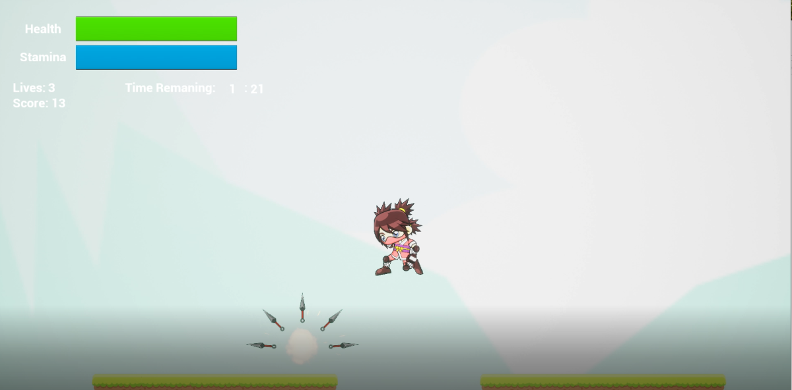

# Ninja Platformer

A 2D action platformer with three levels that I built solo in Unreal Engine 4 for my Level 3 IT course at Belfast Metropolitan College.

**🎬 Demo video:** https://youtu.be/xAeYd5SrkoY




## What I built
- Started from Unreal's 2D Side Scroller template and built the whole game on top of it in Blueprints
- Turned sprite sheets into Paper2D flipbooks for every move: idle, run, jump, attack, throw, jump attack, jump throw and death
- Wrote the logic for melee and ranged combat, health, stamina, lives, scoring and the level timer
- Built the pickups, traps, end-of-level trigger and UI widgets
- Designed three levels from a tileset

## Features
- Sword attacks and throwable kunai, on the ground and mid-jump
- Exploding traps and kunai traps
- Coins to collect and mushrooms that restore health
- HUD with health and stamina bars, lives, score and a countdown timer
- Title menu and game over screen
- Three levels, with an end-of-level trigger that moves you on to the next

## Project structure
```
Config/            Project settings
Content/
├── Character/     Player sprites and animations
├── Items/         Coins, health, kunai and traps
├── LevelItems/    Floor tiles and level pieces
├── Levels/        Game levels
├── EndLevel/      Level-complete logic
└── Widgets/       HUD, title menu and game over screen
Source/            Original sprite and tileset art
LisanAlGaib.uproject
```

## Run locally
Install Unreal Engine 4 from the Epic Games Launcher, clone the repo, open `LisanAlGaib.uproject`, load `Content/Levels/Level1` and press Play.

## Credits
- Unreal Engine 4 2D Side Scroller template
- Character and tileset art: free packs from [GameArt2D](https://www.gameart2d.com/freebies.html)
- Coin sound: from Super Mario Bros. (© Nintendo), used for educational purposes only

---
*Created as a college project for educational purposes.*
